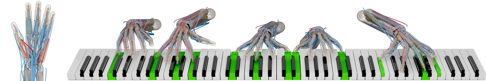

# MUSIC: Learning Muscle-Driven Dexterous Hand Control

This is the official implementation of _MUSIC: Learning Muscle-Driven
Dexterous Hand Control_, on [MuJoCo Warp](https://github.com/google-deepmind/mujoco_warp).
[[Webpage](https://pei-xu.github.io/music)]
[[arXiv](https://arxiv.org/abs/2604.23886)]
[[YouTube](https://youtu.be/tt1D36gE8zM)]
[[TOG](https://doi.org/10.1145/3811402)]



MUSIC is a hierarchical control framework for physics-based piano performance
with anatomically detailed musculoskeletal hands. General single-hand policies
first learn to track a large motion dataset at 480 Hz with muscle-tendon
actuation. Their motion spaces are distilled into compact variational latent
spaces. Piece-specific high-level policies then coordinate both hands at 60 Hz.
They control these latent actions from musical note goals.

## What is new in this version

The first release ran the simulation in MuJoCo MJX with JAX.
This version runs it in MuJoCo Warp, and it does not need JAX.

- **Simulation:** all environments step together on the GPU in `mujoco_warp`, with CUDA graphs.
  The code uses the standard MuJoCo collision pipeline, with no custom collision pruning.
- **Two backends:** `warp` (default) for training on a GPU, and `mujoco` (native MuJoCo on the CPU) for tests, the viewer and audio.
  A Mac without CUDA can run the viewer with the `mujoco` backend.
- **Speed:** on one NVIDIA L40S, with 2048 environments and 60 Hz control steps:
  - The joint-driven piano task runs at about 42,000 control steps per second, or 340,000 physics steps per second.
  - The muscle-driven piano task with 88 muscle tendons runs at about 25,600 control steps per second.
    Each control step runs both tracking policies and the physics 8 times at 480 Hz, so the physics runs at about 205,000 steps per second.
- **Training stability:** a penalty on action standard deviations at the `max_sigma` cap stops a collapse of long training runs.
  An optional value normalizer (PopArt, `--normalize-value`) is also available.
- **Audio:** the viewer can play the piano with a sampled piano sound.

## Setup

### Dependencies

- Python 3.12
- PyTorch 2.14.1 (CUDA 13 build on Linux)
- MuJoCo 3.14.0, MuJoCo Warp 3.14.0 and NVIDIA Warp 1.17.0

Install them with [uv](https://docs.astral.sh/uv/):

```bash
uv sync                    # creates .venv from pyproject.toml
uv sync --extra audio      # also installs sounddevice for audio in the viewer
```

`pyproject.toml` pins the simulation packages and PyTorch to the versions above.
If your uv user configuration adds a private package index, add `--no-config` to the `uv` commands.

### Reference motions

Download the 651-minute reference motion dataset from
[Hugging Face](https://huggingface.co/datasets/xupei0610/MUSIC), about 8.7 GB:

```bash
scripts/download_motions.sh                    # everything -> ./motions
scripts/download_motions.sh --hand right       # one hand
scripts/download_motions.sh --files 000 001    # selected clips, both hands
```

The script writes to `motions/left_hand_motions/` and `motions/right_hand_motions/`.
A second run skips the files that are already present.
The configuration files read the motion list at load time, so training and evaluation both need the dataset.

### Note files

Piano goals are note-event files in `notes/`. Each of the 15 pieces has two versions:

- `<piece>_fingering.txt` gives a finger for each note.
- `<piece>_hand.txt` gives only the hand for each note, and the policy selects the finger.

See [`notes/README.md`](notes/README.md) for the file format and the list of pieces.

### Pretrained policies

Download the pretrained policies from [Hugging Face](https://huggingface.co/datasets/xupei0610/MUSIC), about 2.1 GB:

```bash
scripts/download_pretrained.sh                         # everything -> ./pretrained
scripts/download_pretrained.sh --type joint_hand       # one type
scripts/download_pretrained.sh --type joint_fingering --pieces 017-1 046-1
scripts/download_pretrained.sh --type muscle_hand --pieces 052-1
```

The script writes the files into `pretrained/`:

```text
pretrained/
  joint_fingering/<piece>_fingering.ckpt   # joint-driven, given fingering (15 pieces)
  joint_hand/<piece>_hand.ckpt             # joint-driven, hand only (15 pieces)
  muscle_fingering/<piece>_fingering.ckpt  # muscle-driven, given fingering (15 pieces)
  muscle_hand/<piece>_hand.ckpt            # muscle-driven, hand only (15 pieces)
  muscle_tracking/muscle_tracking_left.ckpt
  muscle_tracking/muscle_tracking_right.ckpt
```

Each file keeps only what running the policy needs: the actor and the observation normalizer.
A file plays the note file with the same name.
For example, `pretrained/joint_hand/052-1_hand.ckpt` plays `notes/052-1_hand.txt`.

Mean scores of the piano policies over the 15 pieces, one full play of each piece:

| Policies | Frame F1 | Note F1 |
|---|---|---|
| `joint_fingering` | 0.990 | 0.983 |
| `joint_hand` | 0.986 | 0.982 |
| `muscle_fingering` | 0.973 | 0.905 |
| `muscle_hand` | 0.964 | 0.890 |

Frame F1 compares the pressed keys with the score at each control frame.
Note F1 matches a played note to a score note on the same key when the onsets are within 50 ms of each other.

## Usage

All commands run from the repository root.
Use `--device <GPU_ID>` to select a GPU. The default is `0`.
Training writes its checkpoints and TensorBoard logs to the directory that `--ckpt` gives.

### Joint-driven piano control

Train a piece-specific policy:

```bash
uv run python main.py cfg/joint.py \
  --note notes/017-1_fingering.txt \
  --ckpt runs/joint_017_fingering
```

`cfg/joint.py` trains for 25,000 epochs and saves `ckpt-<epoch>` every 5,000 epochs.
It also updates `ckpt` every 100 epochs.

Evaluate a pretrained policy:

```bash
uv run python main.py cfg/joint.py \
  --note notes/017-1_fingering.txt \
  --ckpt pretrained/joint_fingering/017-1_fingering.ckpt \
  --test
```

### Low-level muscle tracking

Train one general tracking policy for each hand:

```bash
uv run python main.py cfg/muscle_tracking_left.py  --ckpt runs/muscle_tracking_left
uv run python main.py cfg/muscle_tracking_right.py --ckpt runs/muscle_tracking_right
```

Evaluate the pretrained tracking policies:

```bash
uv run python main.py cfg/muscle_tracking_left.py \
  --ckpt pretrained/muscle_tracking/muscle_tracking_left.ckpt --test
uv run python main.py cfg/muscle_tracking_right.py \
  --ckpt pretrained/muscle_tracking/muscle_tracking_right.ckpt --test
```

### High-level muscle-driven piano control

A piece-specific high-level policy coordinates the two tracking policies.
By default, it loads `pretrained/muscle_tracking/muscle_tracking_{left,right}.ckpt`.
Two configurations train it:

- `cfg/muscle_full.py` starts each episode at the first note and ends it with the last note.
  The pretrained muscle-driven piano policies use this configuration.
- `cfg/muscle.py` starts each episode at a random note, with importance sampling, as `cfg/joint.py` does.
  An episode lasts at most 2.5 s.

```bash
uv run python main.py cfg/muscle_full.py \
  --note notes/017-1_fingering.txt \
  --ckpt runs/muscle_017_fingering
```

Evaluate a pretrained policy:

```bash
uv run python main.py cfg/muscle_full.py \
  --note notes/017-1_fingering.txt \
  --ckpt pretrained/muscle_fingering/017-1_fingering.ckpt \
  --test
```

For the policies without fingering, use `notes/<piece>_hand.txt` and `pretrained/muscle_hand/<piece>_hand.ckpt`.
The piano model has a keybed under the keys (`P:bottom_frame`) that collides with the fingers.
So a policy cannot move its fingers under the keys.

### Continue a training run

Repeat the training command and add `--resume`.
Training then continues from the latest `ckpt` in that directory.

```bash
uv run python main.py cfg/muscle.py \
  --note notes/017-1_fingering.txt \
  --ckpt runs/muscle_017_fingering \
  --resume
```

A run that used `--normalize-value` needs this option again for `--resume` and `--test`.

## Viewer and audio

`--test` opens the MuJoCo viewer and plays the policy in real time.
The viewer needs a display. On a remote host, use `ssh -X` or VNC.
Press **P** to pause and resume.

To run the viewer with audio on the CPU, use the native MuJoCo backend:

```bash
uv sync --extra audio
uv run python main.py cfg/joint.py --backend mujoco --device cpu --test \
  --note notes/046-1_fingering.txt \
  --ckpt pretrained/joint_fingering/046-1_fingering.ckpt
```

On macOS, the viewer needs `mjpython`. Use `scripts/mjpython.sh` in place of `uv run python`:

```bash
scripts/mjpython.sh main.py cfg/joint.py --backend mujoco --device cpu --test \
  --note notes/046-1_fingering.txt \
  --ckpt pretrained/joint_fingering/046-1_fingering.ckpt
```

The script sets `DYLD_FALLBACK_LIBRARY_PATH`.
Without it, `mjpython` cannot find the `libpython3.12.dylib` of the Python that uv installs.

## Repository layout

```text
main.py                # training and evaluation entry point
env.py                 # tasks: PianoJointPD, PianoMuscleDriven, MuscleTracking
sim/                   # simulators: warp_sim.py (mujoco_warp) and mujoco_sim.py (native MuJoCo)
models.py              # actor-critic, discriminator, observation and value normalizers
mujoco_warp_patch.py   # float32 fix for the inside-wrap tendon computation of mujoco_warp
ref_motion.py          # reference motion loader
piano_audio.py         # piano audio for the viewer
utils.py               # quaternion helpers
cfg/                   # configuration files
assets/                # hand and piano models
notes/                 # note-event files
scripts/               # downloads of motions and pretrained policies, and the macOS viewer wrapper
```

## Troubleshooting

- **`nefc overflow` or `broadphase overflow`:** a world has more contacts or constraints than its buffer holds.
  Increase `nconmax` or `njmax` in the `env_params` of the configuration.
  These sizes are per world, so the memory grows with the number of environments.
- **Too many open files:** at import, `env.py` raises the open-file limit to 65,536 or to the hard limit, whichever is lower.
  If your hard limit is lower than that, increase it before you start.
- **`BrokenPipeError` from the reference-motion queue:** a sampling process stopped.
  The error message gives the exit code of the queue manager and of each sampling worker.
  A negative code `-N` means that signal `N` stopped the process.

## License

The code is released under the [MIT License](LICENSE).
The source datasets keep their own licenses. See the data attribution below.

## Data attribution

The reference motions are retargeted from the
[ForElise](https://for-elise.github.io/) piano performance dataset. The note
files are extracted from the
[Piano Fingering Dataset (PIG)](https://beam.kisarazu.ac.jp/research/PianoFingeringDataset/).
Please follow the licenses and citation requirements of the source datasets.

## Citation

If you use this code, the hand model or the motion data, please cite:

```bibtex
@article{music,
  author = {Xu, Pei and Ye, Yufei and Sun, Shuchun and Ding, Yu and Schumann, Elizabeth and Liu, C. Karen},
  title = {{MUSIC}: Learning Muscle-Driven Dexterous Hand Control},
  journal = {ACM Transactions on Graphics},
  volume = {45},
  number = {4},
  year = {2026},
  doi = {10.1145/3811402}
}
```
